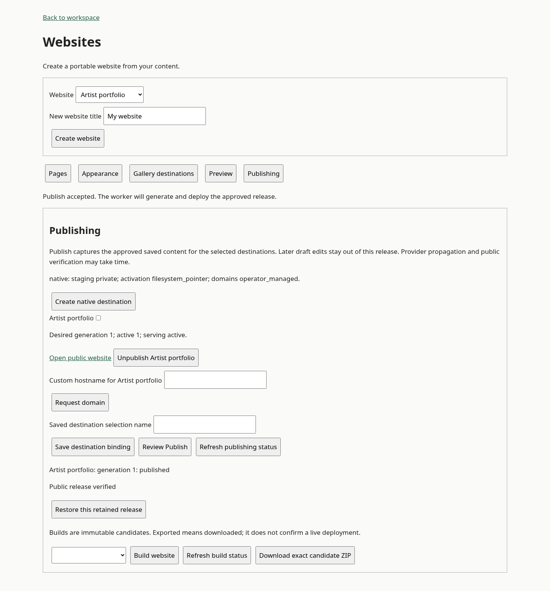

# Website hosting and publishing

This branch extends the native website export implementation with an explicit v2 hosting contract, durable publishing and five hosting families. The initial implementation is **not release-ready** until the gates below are closed. Provider fixtures and a synthesized AWS stack are not live-provider validation.

## Repository mapping

| Concern | Implementation |
| --- | --- |
| Original v1 export contract, website entities and renderer | `packages/core/src/websites.ts`, `packages/ui/src/website-renderer.ts` (reused) |
| Hosting v2, capabilities, connection/target/domain/binding records | `packages/core/src/website-hosting.ts` |
| Durable plans, snapshots, intents, attempts and outbox | `packages/persistence/src/website-hosting.ts`, `adapters/local/src/websites.ts` |
| Publication authorization and frozen source capture | `packages/portability/src/website-service.ts` |
| Publish, retry, fencing, reconciliation, rollback, policy gates | `packages/portability/src/website-publishing.ts` |
| Native filesystem publisher and read-only HTTP data plane | `adapters/local/src/website-hosting.ts` |
| Workload-authenticated S3/KVS adapter and edge router | `adapters/aws/src/website-hosting.ts` |
| Standard CloudFront distribution, OAC, private buckets, KVS and logging | `deployments/aws-serverless/single-cell/lib/website-hosting.ts` |
| OAuth/token/key connections and provider protocols | `packages/integrations/src/website-hosting-*.ts` |
| Personal reference APIs, background worker and publishing UI | `apps/reference-api/src/website-hosting*.ts`, `packages/ui/src/website-workspace.ts` |

`StaticDeploymentAdapter` v1 remains unchanged. `WebsiteHostingAdapter` has `apiVersion: '2'`; registration rejects another version. Provider adapters upload the same native renderer output, with pure provider configuration transforms before artifact hashing. No provider renderer or repository build is introduced.

## Publication and recovery

Save edits private drafts. Review captures the saved website, documents, eligible publication catalogue, clean public renditions, source revision vector, release-policy revision, limits, actor and selected target/account/config revisions. Binary bytes are stored privately; approval fingerprints use their checksums. Plans expire after fifteen minutes. A saved destination binding reuses a target selection; its revision/enabled state is checked again at execution.

Publish accepts that exact fingerprint and writes the authoritative intent, per-target generations, attempts and outbox in one SQLite transaction. `recoverOutbox()` inserts into a **durable**, idempotent queue and then acknowledges each outbox row. A crash between those operations safely repeats insertion. A transient event bus is not a suitable queue port. Execution renders only the stored snapshot, including target-specific canonical URLs and base paths. It does not re-fetch drafts. Full-site regeneration updates dependent lists, pagination, links, navigation and metadata together.

The shared Publish API is also the destination-binding publication event. A consuming product integrating its own content Publish flow must capture/review the approved website source selection and accept this intent as part of that flow. The reference UI publishes the website's explicitly selected, already-public gallery presentations. It does not automatically treat every unrelated Work publication or matching draft as authorization to deploy a website.

Each target has a desired generation, active generation and durable execution owner. Pre-activation workers can be fenced. Once activation might have started, a lease expiry does not transfer the writer. Unknown results retain the target lock. Reconciliation reads provider association and release markers; it never repeats the serving-changing request. An explicit 4xx rejection of that request can settle failure/reconnect and respect a provider cooldown; a lost response stays unknown. Two destinations settle independently.

A deployment becomes Published only after provider/pointer association and a bounded public HTTP probe confirm its opaque release marker, home/nested routes, stylesheet/media types and missing-route behavior. Provider credentials never go to public probes. Public staging URLs are not private previews. Netlify draft deploys are explicitly public.

Rollback uses retained exact target-variant bytes and rechecks current membership, publishing identity, eligibility and release policy. Hosting does not require private ZIP export authority. Products supply hosting entitlements through `hostingEnabled` and authorization ports; private export remains independent.

### Unknown or mixed SFTP recovery

1. Reconcile the recorded attempt and remote release. Never clear a lock because a timeout elapsed.
2. If association cannot be established, stop every possible writer and independently establish that it cannot resume remote writes.
3. The installation can supply `confirmQuiescent`; `releaseRecoveryLock()` requires its verified proof reference. A creator boolean is not proof. The reference HTTP API does not expose this operator-only escape hatch.
4. Retry the settled attempt to repair from the same artifact, or separately approve a newer release. In-place repair may expose mixed files until all pages and the final marker are complete.

## Capability matrix

| Family/profile | Staging | Activation | Rollback | Unpublish | Domains | Policy gate |
| --- | --- | --- | --- | --- | --- | --- |
| Native persistent filesystem | Private | Same-filesystem pointer replacement | Exact artifact | Confirmed pointer removal | Operator DNS/TLS | Independent serving file |
| AWS standard CloudFront/KVS | Private S3/OAC | Conditional host mapping | Exact artifact | KVS tombstone | Operator DNS/certificate/distribution | Separate edge deny key |
| Netlify | **Public** draft deploy | Promote exact deploy ID | Redeploy retained artifact | Operator required | Provider alias/certificate workflow | Operator required |
| Cloudflare Pages | Public asset staging | Production deploy POST combines upload/activation | Redeploy retained artifact | Operator required | Pages domain association/status | Operator required |
| SFTP pointer | Private only with verified server configuration | Probed OpenSSH pointer replacement | Retained artifact | Empty serving pointer | Operator DNS/TLS | Operator required |
| SFTP in-place | None | Assets, temporary pages/rename, owned stale files, marker last | Repair/redeploy; mixed transitions | Remove owned inventory only | Operator DNS/TLS | Operator required |

The pointer SFTP target is saved only after the real protocol probe succeeds and its operator confirms protected staging and retained-assets routing. Authentication alone does not establish atomic activation. The SFTP remote identity binds account, hostname, port and exact root; root/ancestor symlinks and changed host fingerprints fail closed. Key custody is separate from target configuration. No shell, exec, SSH command or rsync is used.

Custom-domain state is independent of content state. Requests preserve the working URL. Netlify requests aliases while preserving existing aliases and reports certificate readiness; Pages records ownership/certificate pending states. Native/AWS/SFTP emit operator instructions. Domain readiness does not automatically switch canonicals: a primary URL change needs an approved target variant, provider association and successful public serving verification. No registrar or domain-purchase flow exists.

## Provider API notes

Reviewed against the following provider documentation and official client implementations on 2026-10-19:

- [Netlify API guide](https://docs.netlify.com/api-and-cli-guides/api-guides/get-started-with-api/) and [OpenAPI](https://github.com/netlify/open-api/blob/master/swagger.yml): public OAuth application, documented implicit grant, API v1, SHA1 file manifest, `draft: true`, missing-file PUTs, ready polling and **POST** `sites/{site}/deploys/{deploy}/restore`. The callback immediately strips the URL fragment and submits the token over the authenticated same-origin API into the vault. State is one-use and bound to actor, workspace, installation, redirect, account and reconnect identity. There is no default PAT workflow.
- [Pages Direct Upload](https://developers.cloudflare.com/pages/get-started/direct-upload/), [deployment API](https://developers.cloudflare.com/api/resources/pages/subresources/projects/subresources/deployments/methods/create/) and [Wrangler](https://github.com/cloudflare/workers-sdk/tree/main/packages/wrangler/src/api/pages): restricted Pages token/account, Direct Upload only, upload JWT, missing-asset/upload/upsert APIs, BLAKE3 of base64 bytes plus extension (first 32 hex characters), slash-prefixed manifest, multipart `_redirects`, production branch and release-correlated commit hash. Canonical deployment association and public marker confirm success. Git projects are rejected. Limits: 20,000 files, 25 MiB/file; this implementation additionally caps total output at 512 MiB.
- [CloudFront KVS](https://docs.aws.amazon.com/AmazonCloudFront/latest/DeveloperGuide/kvs-with-functions.html): Describe ETag/conditional UpdateKeys. File-presence indexes and host mappings are separate. Viewer-request rewrites include site and release before cache lookup; hashed media uses a site-scoped retained namespace. Unknown hosts/files return 404, configuration/lookup failures 503, and suspended/disabled sites 410 before cache lookup. Origin 403 is not rewritten into a misleading custom 404. The standard topology has 1,000 files per artifact and one host/base-path mapping per site; KVS capacity and aggregate retained indexes require operator monitoring. This does not claim the distribution-tenant topology or unlimited sites per KVS.

## Native deployment recipes

### Persistent VPS

Build the repository. Set `UBEEQ_DATA_DIRECTORY`, `UBEEQ_WEBSITE_HOSTING_ROOT` (a dedicated persistent absolute path) and `UBEEQ_WEBSITE_HOSTING_URL_TEMPLATE` (one `{site}` placeholder, normalized directory path). Run the reference API and one worker, then `node apps/reference-api/dist/website-server.js` on port 4200. Put a TLS reverse proxy in front of the static process and preserve the exact Host. The public URL must be reachable by the publisher's HTTP probes. Keep the editor/API origin separate from creator-controlled public hosting origins.

Mount only release storage into the static runtime, read-only; it opens no editor database or vault. Never expose the release root with an unrestricted directory server. The serving component checks the host, owner and independent serving gate, rejects encoded traversal/internal paths, and then reads the current release or a retained content-addressed asset. Complete files and nested directories are fsynced before release-directory rename; pointer replacement is probed on the actual configured filesystem. A gate writer holds a filesystem lock while rechecking resume authority; the static handler denies serving while that lock exists. A crashed gate lock must be removed only after its writer is proven stopped. One publisher and local rename semantics are required. NFS/shared-volume replicas and cross-device pointer moves are not supported by this profile.

### Compose

From the repository root:

```sh
npm run build
npm run package:lambda --workspace @ubeeq/reference-api
docker compose -f examples/website-hosting/compose.yaml up --build -d
node examples/website-hosting/smoke.mjs
docker compose -f examples/website-hosting/compose.yaml restart api publisher static
node examples/website-hosting/smoke.mjs verify
```

The image packages dependencies built for the same architecture and libc. Private application and public release storage use separate named volumes. The static container mounts only public releases, read-only. Default URLs are internal test URLs; the smoke harness connects through loopback while preserving the configured Host. For a real installation set `WEBSITE_URL_TEMPLATE` and `API_PUBLIC_URL`, provide TLS routing and persistent backups. Do not remove production volumes during upgrades.

### Kubernetes

`deployments/kubernetes/website-hosting/hosting.yaml` provides a PVC, one Recreate deployment containing API, publisher and static containers, and a Service. The static container mounts only the public-release subpath, read-only. All processes use UID/GID 1000 with a writable PVC, dropped capabilities and read-only root filesystems. Supply the built image, a storage class with verified persistence/rename semantics, production URLs, TLS ingress and secret handling. Keep `replicas: 1`; do not split the RWO volume across arbitrary publisher/server nodes.

A cluster acceptance run must publish using the smoke harness, delete the pod, wait for replacement, re-establish port-forward/ingress and run `smoke.mjs verify` against the identical marker. Then test the declared driver's detach/reattach/rescheduling behavior. `scripts/validate-website-hosting-kubernetes.py` checks YAML contracts offline (requires PyYAML); it does not validate storage semantics.

## Operations

Connections require manager authority. External reference composition additionally requires an explicit vault encryption key, trusted outbound URL policy, and an SFTP host/port policy. Secrets are stored using the existing credential vault, never in website artifacts, target config, audit payloads or public probes. Configure private DNS/address denial and rebinding-resistant resolution in those outbound ports; no general arbitrary-host policy is supplied by the reference. Reconnect preserves the original account; switching accounts creates a new connection/target.

Monitor outbox age, queued/unknown/verifying attempts, desired versus active generation, `retryAfter`, provider cooldowns, stale locks, verification reasons, private snapshot/artifact bytes, retained public bytes, KVS capacity and audit events. Audit events cover acceptance, deployment outcomes, domains, policy suspension/operator removal, resume and writer-fencing recovery. Hook them into the consuming product's metrics/alerts. The public static process has a credential-free `/health` endpoint; it does not prove an individual release is verified.

The reference worker recovers authoritative active moderation holds and applies policy gates to dependent local sites on a bounded scan. Gates independently deny HTML and retained assets, even if an uncertain old activation later changes the release pointer. A released hold does not automatically resume serving. Resume rechecks current release eligibility and existing remote association. Products must call `suspendDependencies` for other policy/offboarding/withdrawal events and perform provider/server takedown where the adapter reports operator removal required. Already-delivered browser copies cannot be recalled; edge propagation and cache purge are distinct from control-plane acceptance.

Run `cleanupExpiredReviews()` periodically to remove expired reviews/snapshots that never became accepted intents. Accepted snapshots, exact artifacts and minimal ownership/release records are retained for recovery and rollback. This initial implementation deliberately does not automatically delete retained releases or public assets. Before production, enforce aggregate storage budgets and a product retention/purge policy that protects active/rollback artifacts and still-permitted hashed assets referenced by cached HTML. Forbidden media is an exception to retention: gate serving first, then remove it from retained namespaces and invalidate relevant provider caches. Never purge ownership/tombstone records before serving removal is confirmed.

## Validation and open release gates

Implemented tests cover frozen drafts, private-export-independent Publish, outbox recovery, supersession, independent destinations, execution fencing, lost-response reconciliation, exact-artifact repair/rollback, policy gates/resume, retained-media withdrawal, expired-review cleanup, destination bindings, API/worker HTTP publication, provider manifests/association/drift, OAuth replay/account binding, SFTP protocol safety/host-key rejection, and synthesized private OAC/KVS/logging topology.

The full repository suite passed 793 reported tests. The Compose smoke test published and verified a release over HTTP, restarted all three processes, and verified the same marker afterward. A Chromium browser check completed destination creation, review, Publish and verified status with no page errors; desktop and mobile views were captured. The browser check also found and fixed the reference page CSP that blocked its editor bundle. The Kubernetes manifest contracts pass offline. A disposable kind run was attempted with both overlay and native snapshotters; this managed environment cannot mount nested pod root filesystems (`failed to mount rootfs component: invalid argument`). No Kubernetes rescheduling success is claimed.

Remaining release gates: a real persistent Kubernetes/storage-driver acceptance run; authorized sandbox/test-target checks for Netlify OAuth, Pages, representative real SFTP servers and AWS DNS/TLS/CDN propagation; primary-domain cutover/ownership collision checks across consuming installations; aggregate retention/quota/purge automation; product-specific content-publication event integration and policy/offboarding event coverage; and production-grade persistence/vault/outbound-policy composition. AWS products must supply a durable `WebsiteHostingStore`/artifact store for their runtime (the included concrete hosting state store is SQLite), their own infrastructure and IAM, and paid-hosting policy. No production resources were provisioned for validation.


